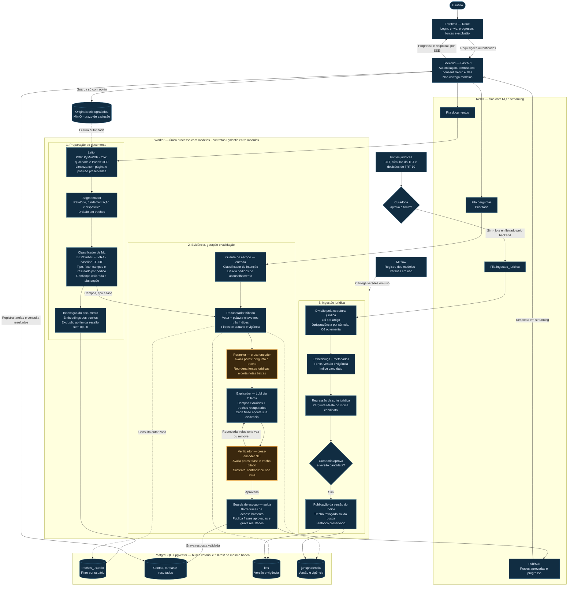

**Documentos trabalhistas em linguagem simples, com fontes que você pode conferir.**

Aplicação de IA para ajudar trabalhadores a compreender documentos de processos trabalhistas, identificar a situação descrita e explorar possíveis próximos passos, com explicações acessíveis e referências às fontes.

Projeto acadêmico desenvolvido no **Desafio 2 da Residência em Inteligência Artificial**, com o tema **Qualidade de vida** e foco inicial na Justiça do Trabalho, tendo o TRT-10 como piloto.

> **Em planejamento.** Este repositório contém a documentação do projeto. A aplicação, os modelos e o ambiente de execução ainda serão implementados.

[Manual de MLOps e arquitetura](<docs/Manual de MLOps e arquitetura — Desafio 2 (direitos trabalhistas).docx>) · [Desafio original](<docs/Challenge 2.docx.pdf>)

## Por que este projeto existe?

Uma decisão judicial pode mudar a vida de alguém e, ainda assim, ser difícil de entender. Termos técnicos, documentos extensos e dúvidas sobre o andamento do processo tornam essa experiência ainda mais complicada.

Queremos ajudar a pessoa a compreender **o que está escrito, onde essa informação aparece e o que ainda não é possível concluir**.

A ferramenta terá caráter informativo. Orientações sobre decisões concretas do caso continuam dependendo de assistência jurídica profissional.

## A experiência que queremos construir

1. **Envie um documento:** PDF ou imagem, com escolha explícita sobre a guarda do arquivo.
2. **Acompanhe a leitura:** veja o progresso e eventuais problemas de legibilidade.
3. **Entenda o conteúdo:** receba uma explicação simples, com o trecho original ao lado.
4. **Confira as fontes:** localize o documento, a página ou a fonte jurídica que sustenta cada afirmação.
5. **Faça perguntas:** explore termos e informações presentes no material autorizado.
6. **Controle seus dados:** consulte as opções de retenção e exclusão.

A situação apresentada será a **última identificada nos documentos enviados**, com data de referência e limitações. O MVP não prevê consulta automática ao PJe ou ao DataJud.

## Funcionalidades planejadas

| Frente | Entrega prevista |
| --- | --- |
| Leitura de documentos | Extração de texto de PDFs e OCR para imagens, preservando página e posição |
| Organização do conteúdo | Separação de relatório, fundamentação e dispositivo, com divisão em trechos |
| Classificação e extração | Identificação de tipo documental, fase, campos e resultado por pedido |
| Explicação acessível | Resumos em linguagem simples, com o dispositivo literal para conferência |
| Perguntas com fontes | Recuperação de evidências dos documentos do usuário, das leis e da jurisprudência |
| Próximos passos | Possibilidades condicionais e checklists aprovados pela Curadoria jurídica |
| Validação | Verificação das frases antes de exibi-las, com sinalização de incertezas |
| Privacidade | Isolamento por usuário, guarda opcional e exclusão de dados e derivados |

## Arquitetura planejada

Cinco serviços principais — frontend, backend, Redis, worker e PostgreSQL — com armazenamento de originais e MLflow como apoio. O worker concentra o processamento com modelos e organiza o trabalho em três pipelines.

O backend autentica, verifica permissões e encaminha tarefas. **Todo processamento com modelos acontece no worker**, em três pipelines: documentos, perguntas e ingestão jurídica. Perguntas têm prioridade na fila.

O banco mantém o estado das tarefas e os resultados. O Pub/Sub entrega eventos ao backend, que os repassa à interface por SSE. A publicação será por frase, depois da verificação.

### Stack definida no manual

| Camada | Tecnologias previstas |
| --- | --- |
| Interface | React e TypeScript |
| API e contratos | Python, FastAPI e Pydantic |
| Filas e eventos | Redis, RQ e Pub/Sub |
| Dados e busca | PostgreSQL, pgvector e busca textual em português |
| Leitura | PyMuPDF e PaddleOCR |
| IA generativa | Modelos locais via Ollama, embeddings e RAG |
| Modelos avaliáveis | Baselines com regras e TF-IDF; BERTimbau e cross-encoders a avaliar |
| MLOps | MLflow, DVC, Label Studio e Evidently |
| Arquivos e ambiente | MinIO, uv e Docker Compose |

Versões, licenças e desempenho serão confirmados durante a implementação. No ambiente macOS previsto no manual, worker e Ollama executarão nativamente; PostgreSQL, Redis, MLflow e MinIO serão organizados pelo Docker Compose.

## Dados, evidências e qualidade

O projeto terá três conjuntos de busca: **`trechos_usuario`**, **`leis`** e **`jurisprudencia`**. Os documentos privados serão filtrados pelo usuário autorizado; as fontes jurídicas terão origem, versão e informações de vigência.

As práticas previstas incluem:

- Preservar a origem de cada trecho, incluindo página e posição.
- Anonimizar o acervo de desenvolvimento e versionar dados e rótulos com DVC.
- Separar treino, validação e teste por processo, evitando vazamento entre conjuntos.
- Validar os contratos entre módulos e os esquemas dos lotes.
- Comparar modelos com baselines e registrar experimentos e versões no MLflow.
- Avaliar extração, segmentação, classificação, recuperação e fidelidade das explicações.
- Submeter mudanças de modelos, prompts e índices a testes e revisão antes de promover uma versão.
- Bloquear versões com erros graves no conjunto de avaliação.

As metas quantitativas serão estabelecidas após medir os primeiros baselines. Os controles descritos aqui são compromissos de implementação; ainda não representam resultados alcançados.

## Privacidade desde o início

O manual prevê processamento local dos modelos e uso de dados sintéticos ou anonimizados no desenvolvimento. Documentos pessoais e segredos não devem entrar no Git.

A guarda de originais dependerá de escolha explícita do usuário. Sem essa escolha, documento, trechos e resultados deverão ser removidos ao fim da sessão; com guarda, serão aplicados controles de acesso, criptografia e prazo de exclusão. Logs deverão registrar apenas informações operacionais, sem reproduzir o conteúdo dos documentos.

## Quem faz o quê

| Papel | Responsabilidade principal | Responsável |
| --- | --- | --- |
| Engenharia de dados | Acervo, anonimização, leitor, segmentador por regras, divisão estrutural das fontes e contratos de dados | Davi |
| Ciência de dados | Taxonomia, anotação, conjuntos de referência, métricas, análise de erros e testes com pessoas | Laisa |
| Engenharia de ML e MLOps | Classificadores, reranker, verificador, experimentos, registro de modelos e monitoramento | Felipe |
| Engenharia de IA | Índices, recuperação, embeddings, LLM, prompts e integração da validação das respostas | Mayara |
| Engenharia de software | Frontend, backend, banco, migrações, filas, autenticação, infraestrutura e integração | João |
| Curadoria jurídica | Aprovação das fontes, rótulos jurídicos, limites de uso e revisão das explicações | Laisa |

## Roteiro de desenvolvimento

| Semana | Foco |
| --- | --- |
| 1 | Escopo, fontes, anonimização, contratos, métricas e ambiente |
| 2 | Primeiro lote de dados e recuperação de fontes jurídicas |
| 3 | Comparação entre LLM, RAG, reranker e verificador |
| 4 | Integração dos módulos e primeiro fluxo completo |
| 5 | Leitura de imagens, OCR e avaliação de fotos |
| 6 | Integração completa, monitoramento e preparação da demonstração |
| 7 | Testes com pessoas, refinamento e apresentação final |

O roteiro segue o manual e depende dos portões de qualidade de cada etapa.

